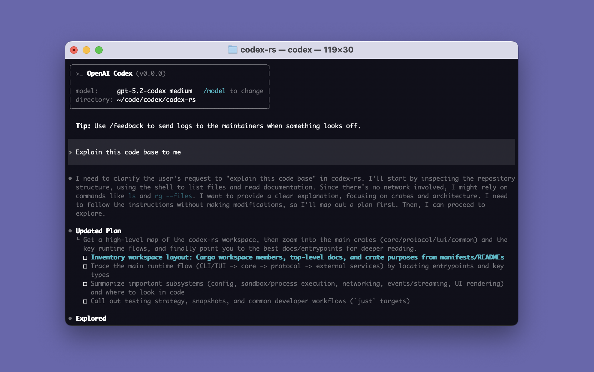

# Suno by Ace Data Cloud for Codex

Music generation, custom lyrics, song extension and covers in Codex, provided by **Ace Data Cloud**. This independent plugin reuses the [existing Suno MCP](https://github.com/AceDataCloud/MCPs/tree/main/suno); it does not duplicate the server or change its billing. It is not published or endorsed by the service brand or by OpenAI.

[简体中文](readme/README_zh_Hans.md) · [Current API pricing](https://platform.acedata.cloud/models?utm_source=opensource&utm_medium=referral&utm_campaign=evergreen&utm_content=sunocodex_readme_pricing) · [Register / sign in](https://platform.acedata.cloud/?utm_source=opensource&utm_medium=referral&utm_campaign=evergreen&utm_content=sunocodex_readme_register)

## 1. Install the correct native plugin

The target is the Codex official plugin directory with the name **Suno by Ace Data Cloud**. **Official listing is not live.** The [official catalog](https://github.com/openai/plugins) submission and review are separate from this source package. Do not expect the default official search to find this integration until it is accepted.

For the released third-party installation, add this service's marketplace using Codex 0.163.0 or later:

```bash
codex plugin marketplace add AceDataCloud/SunoCodex --ref v0.1.0
codex plugin add suno@acedatacloud-suno --json
```

This pins the published `v0.1.0` release. It is a third-party marketplace, not the official default catalog. Inspect the source and release before installing. In Codex's plugin interface, search **Suno** within that added marketplace and check the publisher is **Ace Data Cloud**. The CLI `plugin list --available --marketplace acedatacloud-suno --json` exposes the same plugin metadata. Adding a marketplace alone does not install its plugin; adding this plugin installs only Suno.

## 2. Get a service API key

1. [Register or sign in to Ace Data Cloud](https://platform.acedata.cloud/?utm_source=opensource&utm_medium=referral&utm_campaign=evergreen&utm_content=sunocodex_readme_register). Open [Applications](https://platform.acedata.cloud/console/applications?utm_source=opensource&utm_medium=referral&utm_campaign=evergreen&utm_content=sunocodex_readme_api_key). If absent, choose **Initialize General Application**.
2. Open **General application**, check Suno access, balance and [current price](https://platform.acedata.cloud/models?utm_source=opensource&utm_medium=referral&utm_campaign=evergreen&utm_content=sunocodex_readme_pricing). Copy its API Key, or choose **Manage Keys → Create** for a separate `Codex Suno` key. A dedicated service key only grants that service.


3. Review expiration, usage limit and Allowed APIs. This plugin uses `/suno/audios` and `/suno/tasks`; allow the operations you actually need. Do not broaden a restricted key automatically.


These are real redacted platform screenshots reused from SunoDify, pinned in [asset sources](assets/sources.json); the older create dialog shows a Dify name—use `Codex Suno` instead. Source capture dates are not declared; verified here 2026-10-18. Never copy the masked screenshot value. Copy only the raw key, without `Bearer ` or quotes. A `platform-...` management token is not a generation key.

## 3. Give the key to the Codex process

This native package reads an environment-backed secret; it does not ask you to edit MCP server URLs. In the terminal that launches Codex:

```bash
export ACEDATACLOUD_API_TOKEN="YOUR_SERVICE_API_KEY"
codex
```

PowerShell: `$env:ACEDATACLOUD_API_TOKEN = "YOUR_SERVICE_API_KEY"`, then `codex`. Start a fresh session and run `/mcp`; the plugin server should connect and show its tools. GUI-launched Codex must inherit the same variable from its launch environment. Do not put the key into a prompt, shared configuration, screenshot or Git. This version does not provide a custom GUI credential dialog.



Official original reference image, not an Ace execution screenshot. It identifies Codex's terminal request area only. The file was updated 2026-01-02; capture date/version are not established. See [source and limits](assets/sources.json). Native plugin search, install and connection screenshots are queued for a real session; no fake UI is included.

## 4. First use and async results

Call `suno_list_models` to show model information without generating.

Generation or editing is a separate, potentially charged action. First confirm the current price, an explicit model/action and permitted spend; then submit once. When a task ID is returned, call `suno_get_task` with that same ID until terminal success or failure. Do not resubmit media generation to check progress. A connected plugin, a green tool call, a pending task or a preview is not a completed media result. After success, open the returned media URLs and inspect the usage record for the same request. This repository does not claim a paid end-to-end run or unique bill acceptance.

## Troubleshooting

| Symptom | Check |
| --- | --- |
| Plugin not in official search | The integration has not been accepted there; use the explicit third-party release route above. |
| Key missing / 401 | Full key in Codex launch environment, no `Bearer ` prefix, correct key type/expiration. |
| 403 | Service/model and Allowed APIs access; do not create wider credentials automatically. |
| 429 | Wait and reduce concurrency. Do not automatically retry a paid submission. |
| Pending / empty media | Query the original task ID, not a new generation. |
| 400 / invalid parameters | Read the live tool schema for that model/action; do not assume all optional fields work together. |
| 5xx / timeout | Preserve task/trace ID and inspect original status before any resubmission. |

## Privacy, cost and support

The plugin is free to install. Requests, service API key and chosen input content are sent to the existing `suno.mcp.acedata.cloud` service and the Ace API; media calls follow your current account pricing. Use content you have permission to process. The key is resolved from the environment and is not embedded in this package. See [Privacy](PRIVACY.md).

[Source](https://github.com/AceDataCloud/SunoCodex) · [Issues](https://github.com/AceDataCloud/SunoCodex/issues) · dev@acedata.cloud

## Development

`python3 -m unittest discover -s tests -v` validates the native metadata, exact service tool scope, no embedded key, and attribution links. `scripts/native_smoke.py --codex /path/to/codex` installs/lists/removes the package in a temporary Codex Home; it never starts a model turn or media generation. Hosted service implementation remains in MCPs.
